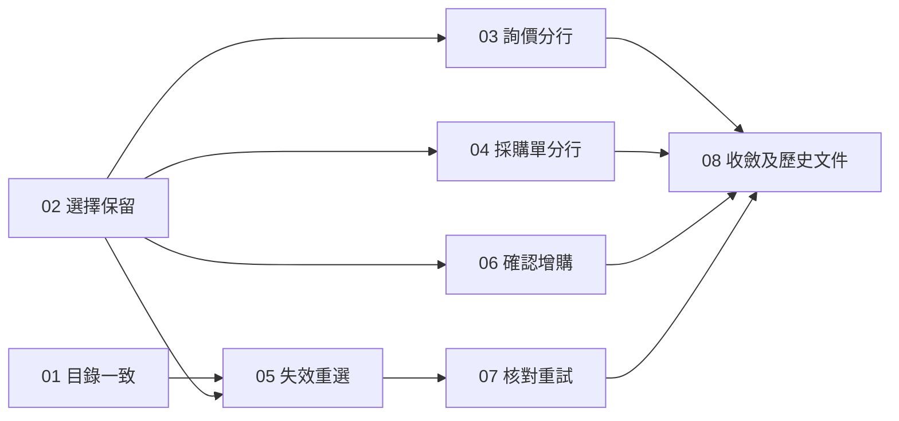

# 買家商品目錄與商品選擇：工作票

[正式規格](spec.md) · 已確認 8 張票，每張都有獨立驗收條件。

| 編號 | 工作票 | Blocked by |
| --- | --- | --- |
| 01 | [買家商品目錄前後一致](issues/01-consistent-buyer-catalog.md) | 無 |
| 02 | [商品選擇完整保留到草稿](issues/02-preserve-product-selection.md) | 無 |
| 03 | [詢價按不同商品選擇分行](issues/03-separate-enquiry-selections.md) | 02 |
| 04 | [採購單按不同商品選擇分行](issues/04-separate-purchase-order-selections.md) | 02 |
| 05 | [失效規格必須重選](issues/05-reselect-invalid-options.md) | 01、02 |
| 06 | [最低購買量提高須確認增購](issues/06-confirm-minimum-quantity.md) | 02 |
| 07 | [核對失敗保留草稿並重試](issues/07-retry-catalog-verification.md) | 05 |
| 08 | [收斂舊流程及驗收歷史文件](issues/08-consolidate-selection-and-history.md) | 03、04、06、07 |

## 開工規則

- 初始可開工票為 **01、02**。實際可開工集合，按各票當前狀態及阻塞票是否完成計算。
- `ready-for-agent` 表示內容足夠清楚，不代表可以忽略阻塞關係。
- 先完成 01、02 的相容重整，再推進依賴它們的行為改動；過渡期間保留舊草稿及尚未遷移流程的相容性。
- 08 是最後的收斂票，須等所列阻塞票完成才移除已無 caller 的舊流程；歷史資料讀取相容性仍須保留。
- 每票完成其驗收後，將該票 `Status` 改為 `done`，並在 `## Comments` 記錄驗證結果。索引供導覽，狀態以各票檔案為準。

[實作驗收與 review](review.md)
